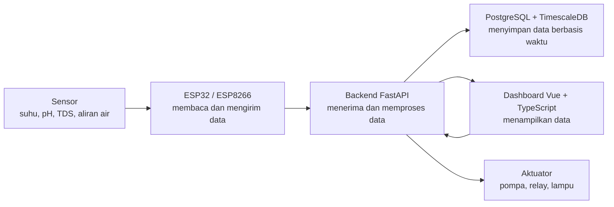
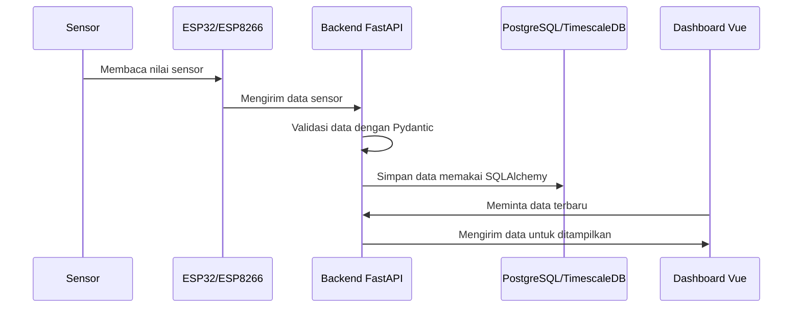
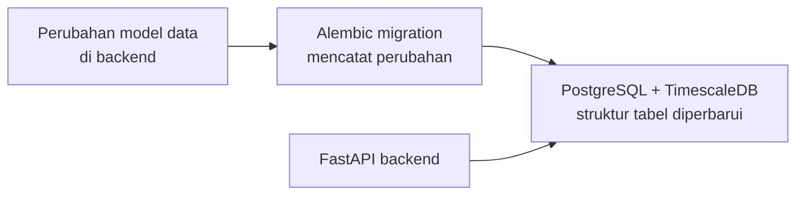

# Arsitektur Sistem

## Tujuan Bagian Ini

Bagian ini menjelaskan hubungan antara hardware, backend, database, dan dashboard. Setelah membaca bagian ini, Anda diharapkan memahami ke mana data sensor bergerak dan bagaimana perintah kontrol dikirim.

## Gambaran Besar

Smart Hydroponic memakai pola sederhana:



Sensor membaca kondisi tanaman atau lingkungan. Mikrokontroler mengirim data ke backend. Backend menyimpan data ke database dan menyediakan data untuk dashboard. Dashboard digunakan pengguna untuk memantau nilai sensor dan mengirim perintah kontrol.

Diagram ini sengaja dibuat sederhana. Detail teknisnya bisa dipelajari bertahap setelah alur besarnya terasa masuk akal.

## Alur Pengiriman Data Sensor



Alur di atas menunjukkan satu skenario umum: data bergerak dari perangkat fisik sampai muncul di dashboard.

## Alur Perubahan Struktur Database



Alembic dipakai agar perubahan tabel database tidak dilakukan secara asal. Setiap perubahan dicatat sehingga tim bisa menjalankan perubahan yang sama di laptop atau server.

## Peran Setiap Bagian

### Sensor dan Aktuator

Sensor membaca kondisi nyata, seperti suhu, kelembaban, pH, TDS, aliran air, dan tinggi air. Aktuator melakukan aksi, misalnya menyalakan pompa atau lampu melalui relay.

### ESP32 dan ESP8266

ESP32 dan ESP8266 adalah mikrokontroler. Keduanya bertugas membaca data dari sensor, menyusun data, lalu mengirimkannya ke server. Perangkat ini juga dapat menerima perintah dari server untuk mengendalikan aktuator.

### Backend API

Backend utama saat ini menggunakan Python dan FastAPI. Backend menerima data dari perangkat, menyediakan endpoint untuk dashboard, memvalidasi data dengan Pydantic, dan mengatur akses database melalui SQLAlchemy.

Endpoint penting untuk pengecekan awal:

```text
http://localhost:8000/health
http://localhost:8000/health/ready
```

- `/health` adalah **liveness probe**: proses API hidup dan melayani HTTP. Endpoint ini tidak memeriksa database, sehingga tidak pernah gagal hanya karena PostgreSQL sedang tidak tersedia.
- `/health/ready` adalah **readiness probe**: API siap melayani permintaan yang membutuhkan dependensinya. Endpoint ini menjalankan `SELECT 1` ke database dan membalas `200` dengan `{"status": "ready", ...}` bila database dapat dijangkau, atau `503` dengan `{"status": "unavailable", "checks": {"database": "unreachable"}}` bila tidak. Jawaban ini tidak pernah memuat connection string atau kredensial.

Docker memakai `/health/ready` pada `HEALTHCHECK` image backend, jadi container dianggap `healthy` hanya setelah database dapat dijangkau. Jika container tetap `starting` atau menjadi `unhealthy`, periksa konektivitas database lebih dahulu (lihat [Setup Database](./backend/setup_database.md)).

### Database

Database menggunakan PostgreSQL dengan ekstensi TimescaleDB. TimescaleDB cocok untuk data time-series, yaitu data yang terus bertambah berdasarkan waktu, seperti nilai sensor setiap beberapa detik. Pada pruyek ini, informasi waktu disimpan ke dalam UUID yaitu UUIDv7 yang sudah mengandung informasi waktu, sehingga tidak perlu kolom terpisah untuk timestamp.

### Dashboard Web

Dashboard web menggunakan Vue. Dashboard menampilkan data sensor, membantu pemantauan kondisi sistem, dan menyediakan antarmuka untuk kontrol.

## Protokol Komunikasi

Proyek ini dapat menggunakan beberapa cara komunikasi:

- **REST API** untuk request biasa seperti login, mengambil data, atau mengubah profil nutrisi.
- **WebSocket** untuk komunikasi real-time.
- **CoAP** untuk skenario IoT ringan pada beberapa eksperimen perangkat.

Untuk saat ini, komunikasi utama menggunakan protokol Websocket.

Saat membaca kode, perhatikan folder `esp`, `backend/routes`, dan `frontend-vue/src/api` untuk melihat bagaimana komunikasi tersebut dipakai.

## Kontrak Payload Sensor

Setiap perangkat mengirim payload JSON. Backend memvalidasi payload tersebut dengan skema Pydantic **sebelum** data masuk ke aggregator. Aturan utamanya: **field pengukuran yang wajib tidak boleh dihilangkan**. Jika satu field wajib saja tidak ada, seluruh payload ditolak, tidak dimasukkan ke aggregator, dan tidak disimpan ke database. Dengan begitu, nilai yang hilang tidak pernah berubah menjadi `0` yang terlihat seperti data valid.

### Payload node plant

| Field | Tipe | Wajib | Rentang valid | Keterangan |
| --- | --- | --- | --- | --- |
| `moisture1` – `moisture6` | integer | Ya | ≥ 0 | Kelembapan tanah per sensor (%) |
| `flowrate` | number | Ya | ≥ 0 | Laju aliran air |
| `total_litres` | number | Ya | ≥ 0 | Akumulasi volume air (liter) |
| `distance_cm` | number | Ya | ≥ 0 | Jarak sensor ke permukaan air. Firmware plant mengirimnya dengan nama `water_level`; backend menerima kedua nama tersebut. |

### Payload node environment

| Field | Tipe | Wajib | Rentang valid | Keterangan |
| --- | --- | --- | --- | --- |
| `ph` | number | Ya | ≥ 0 | Nilai pH |
| `tds` | number | Ya | ≥ 0 | Total dissolved solids (ppm) |
| `temperature_atas` | number | Ya | ≥ 0 | Suhu sensor atas (°C) |
| `temperature_bawah` | number | Ya | ≥ 0 | Suhu sensor bawah (°C) |
| `humidity_atas` | number | Ya | ≥ 0 | Kelembapan sensor atas (%) |
| `humidity_bawah` | number | Ya | ≥ 0 | Kelembapan sensor bawah (%) |

### Payload node actuator

| Field | Tipe | Wajib | Keterangan |
| --- | --- | --- | --- |
| `pump_status` | boolean | Tidak | Status perintah pompa |
| `light_status` | boolean | Tidak | Status perintah lampu |
| `automation_status` | boolean | Tidak | Status mode otomatis |

Field aktuator sengaja **opsional** karena protokol aktuator memang mendukung perintah sebagian: firmware ESP8266 hanya menerapkan kunci yang benar-benar dikirim (lihat `esp/esp8266_actuator/esp8266_actuator.ino`).

### Arti nilai hilang, `null`, `0`, dan tidak valid

- **Nilai `0`** adalah pengukuran yang sah dan disimpan apa adanya. Nilai nol tidak pernah dianggap sebagai "data hilang".
- **Field dihilangkan** berarti perangkat gagal melaporkan pengukuran tersebut. Payload ditolak.
- **Nilai `null`** ditolak karena bukan angka yang sah.
- **Nilai tidak valid** (mis. angka negatif atau string) ditolak oleh batas rentang dan tipe.

### Perilaku saat validasi gagal

- **WebSocket:** backend membalas `{"status": "error", "reason": "validation_failed"}` untuk frame tersebut dan menulis entri log `sensor_anomaly` berisi nama field yang ditolak beserta jenis errornya. Nilai pengukuran mentah tidak ditulis ke log.
- **CoAP:** backend membalas `4.00 Bad Request` dan menulis entri log `sensor_anomaly` serupa.

Contoh payload valid:

```json
{
  "moisture1": 45, "moisture2": 45, "moisture3": 45,
  "moisture4": 45, "moisture5": 45, "moisture6": 45,
  "flowrate": 1.5, "total_litres": 10.0, "water_level": 15.0
}
```

Contoh payload tidak valid (ditolak karena `moisture3` tidak ada):

```json
{
  "moisture1": 45, "moisture2": 45,
  "moisture4": 45, "moisture5": 45, "moisture6": 45,
  "flowrate": 1.5, "total_litres": 10.0, "water_level": 15.0
}
```

### Catatan kompatibilitas firmware

- Firmware plant dan environment yang dipakai saat ini sudah mengirim seluruh field wajib, sehingga tidak perlu diubah agar sesuai dengan kontrak ini (`esp/esp32_plant/esp32_plant.ino`, `esp/esp32_environment/esp32_environment.ino`).
- Keterbatasan yang diketahui pada sisi firmware: pembacaan DHT yang gagal (NaN) diubah menjadi `0`, dan nilai pH memakai placeholder `7.0` selama sensor pH belum aktif. Menurut kontrak, nilai tersebut adalah nilai yang dilaporkan perangkat, jadi operator harus waspada bahwa `0 °C`, `0 %`, atau pH `7.0` dapat berarti sensor bermasalah. Memperbaiki ini memerlukan perubahan protokol (misalnya dukungan nilai nullable) di backend dan firmware sekaligus, sehingga belum dilakukan.
- Jalur snapshot menolak payload yang tidak lengkap, jadi data yang tidak konsisten tidak akan tersimpan sebagai pembacaan yang sah.

## Semantik Otomasi Aktuator

Keputusan otomatis pompa dan lampu dihitung dari profil nutrisi aktif. Sistem membedakan tiga keadaan agar tidak pernah mengambil keputusan aktuator tanpa konfigurasi yang sah:

| Keadaan | Profil aktif | Sumber ambang batas | Perilaku otomasi |
| --- | --- | --- | --- |
| Profil aktif tersedia | ada | batas `moisture_min`/`moisture_max` dan `temperature_min`/`temperature_max` profil | keputusan otomatis dijalankan seperti biasa |
| Tidak ada profil aktif | tidak ada | `HYDROPONIC_MOISTURE_THRESHOLD` dan `HYDROPONIC_TEMPERATURE_THRESHOLD` (konfigurasi eksplisit) | fallback normal tetap dijalankan |
| Profil gagal diambil | tidak dapat ditentukan | tidak ada | otomasi **dilewati** dan ditandai *degraded* |

### Kapan otomasi dilewati

Otomasi hanya dilewati ketika:

- `automation_status` bernilai aktif (otomasi diminta berjalan), **dan**
- profil nutrisi tidak dapat ditentukan karena pengambilan gagal — misalnya database sedang tidak tersedia.

Pada keadaan ini backend **tidak** mengganti profil dengan ambang batas generik. Penggantian seperti itu akan terlihat seperti keputusan normal padahal mengabaikan konfigurasi operator, sehingga keputusan otomatis dilewati: status pompa dan lampu dibiarkan apa adanya (tidak ada perintah baru) dan payload aktuator memuat `automation_degraded: true`.

Jika otomasi tidak diminta aktif (`automation_status` non-aktif), gagal mengambil profil tidak memengaruhi apa pun dan tidak pernah menandai otomasi sebagai *degraded*.

### Observabilitas dan pemulihan

- Saat otomasi pertama kali masuk keadaan *degraded*, backend menulis log `automation` berlevel `error` berisi alasan pelewatan. Ketika profil kembali dapat diambil, backend menulis log `automation` berlevel `info` bahwa otomasi pulih. Hanya **transisi** yang dicatat, sehingga gangguan berkepanjangan tidak membanjiri log.
- Kegagalan pengambilan **tidak** disimpan sebagai hasil resolusi. Sebuah kegagalan tidak pernah menyamar sebagai "tidak ada profil aktif", sehingga tidak membuat cache tercemar.
- Ada jeda singkat sebelum percobaan pengambilan berikutnya supaya database yang sedang mati tidak dihantam terus-menerus. Setelah jeda itu berlalu, sistem mencoba lagi secara otomatis dan otomasi kembali normal begitu pengambilan berhasil.

## Semantik Perintah Kontrol Aktuator

Endpoint `POST /hydroponics/control` menerima perintah manual dari dashboard. Sistem membedakan empat tingkat kepastian agar tidak pernah melaporkan keberhasilan eksekusi fisik yang belum terbukti:

| Tingkat | Arti |
| --- | --- |
| **Diterima** | Backend menerima dan memvalidasi permintaan dari pengguna. |
| **Dikirim (*dispatched*)** | Perintah sudah diserahkan ke transport (antrean WebSocket, atau notifikasi Observe CoAP). Ini **bukan** bukti aktuator mengeksekusi perintah. |
| **Dikonfirmasi (*confirmed*)** | Aktuator mengirim balasan yang benar-benar menyatakan perintah diterapkan. |
| **Gagal (*failed*)** | Transport melaporkan pengiriman gagal (mis. semua antrean klien penuh). |

### Field respons

| Field | Tipe | Arti |
| --- | --- | --- |
| `command_id` | string | Identitas unik perintah untuk korelasi log. |
| `confirmed` | boolean | `true` **hanya** bila ada balasan nyata dari aktuator. Saat ini selalu `false` karena protokol yang dipakai tidak menyediakan balasan. |
| `delivery_status` | string | Hasil pengiriman yang benar-benar dapat dipastikan: `confirmed`, `dispatched`, `unavailable`, atau `failed`. |

### Arti `delivery_status`

- `unavailable` — tidak ada aktuator yang dapat dijangkau: tidak ada klien WebSocket yang terhubung, tidak ada observer CoAP yang terdaftar, atau resource aktuator CoAP belum aktif. Perintah **tidak terkirim**.
- `dispatched` — perintah sudah diserahkan ke transport. Eksekusi fisik **belum** terkonfirmasi.
- `failed` — transport melaporkan pengiriman gagal.
- `confirmed` — ada balasan nyata dari aktuator. Nilai ini belum pernah dihasilkan oleh protokol saat ini.

Dashboard tidak pernah menampilkan pesan keberhasilan ketika `delivery_status` bernilai `unavailable` atau `failed`; keadaan `dispatched` ditampilkan sebagai peringatan bahwa eksekusi belum terkonfirmasi.

### Keterbatasan protokol dan catatan firmware

- Aktuator ESP8266 adalah **klien CoAP Observe** (lihat `esp/esp8266_actuator/esp8266_actuator.ino`): ia mendaftar Observe dengan GET, lalu menerapkan kunci payload yang ada. Firmware **tidak** menyediakan handler `PUT`, sehingga tidak ada balasan permintaan/tanggapan.
- Karena itu, sebuah notifikasi Observe hanya membuktikan payload sudah dikirim ke transport, **bukan** bahwa relay benar-benar berubah.
- Klien CoAP keluar (`send_actuator_command_coap`) yang dahulu tidak dipakai sudah dihapus supaya tidak ada dua mekanisme kontrol yang bersaing dan menyesatkan. Untuk mendapatkan `confirmed` yang sebenarnya diperlukan perubahan protokol di **kedua** sisi (firmware aktuator menambah handler balasan, backend menunggu balasan tersebut); hal itu belum dilakukan.
- **Diagnostik kegagalan bersifat satu arah.** Protokol CoAP yang ada tidak menyediakan kanal bagi perangkat untuk melaporkan error parsing-nya ke server, jadi firmware **tidak** bisa membuat kegagalan lokal terlihat di server. Yang tersedia hanyalah arah sebaliknya: firmware kini mencetak kode respons server (`2.04`, `4.00`, `5.03`, `5.00`) beserta verdict-nya, serta nama error ArduinoJson saat parsing gagal, sehingga penolakan server tidak lagi tampak seperti keberhasilan di serial monitor. Alasan penolakan yang sebenarnya tetap hanya muncul di log backend (lihat [Troubleshooting](troubleshooting.md#membaca-diagnostik-firmware)).
- Aktuator memperlakukan `4.xx`/`5.xx` sebagai "state tidak diterapkan" dan menjadwalkan ulang pendaftaran Observe setelah jeda 30 detik; tanpa itu perangkat tetap diam tanpa notifikasi sampai refresh berkala berikutnya.

## Diagram


## Konfigurasi IoT

- [ ] Wiring Diagram ESP32 Node Plant Terbaru
- [ ] Wiring Diagram ESP32 Node Environment Terbaru
- [ ] Wiring Diagram ESP8266 Node Actuator Terbaru

### ESP32 Node Plant

<table>
  <thead>
    <tr>
      <th>Komponen</th>
      <th>Pin Mikrokontroler</th>
      <th>Pin Sensor</th>
    </tr>
  </thead>
  <tbody>
    <tr>
      <td rowspan="3">Sensor Soil Moisture 1</td>
      <td>3V3</td>
      <td>VCC</td>
    </tr>
    <tr>
      <td>GND</td>
      <td>GND</td>
    </tr>
    <tr>
      <td>Pin 32</td>
      <td>SIG</td>
    </tr>
    <tr>
      <td rowspan="3">Sensor Soil Moisture 2</td>
      <td>3V3</td>
      <td>VCC</td>
    </tr>
    <tr>
      <td>GND</td>
      <td>GND</td>
    </tr>
    <tr>
      <td>Pin 33</td>
      <td>SIG</td>
    </tr>
    <tr>
      <td rowspan="3">Sensor Soil Moisture 3</td>
      <td>3V3</td>
      <td>VCC</td>
    </tr>
    <tr>
      <td>GND</td>
      <td>GND</td>
    </tr>
    <tr>
      <td>Pin 34</td>
      <td>SIG</td>
    </tr>
    <tr>
      <td rowspan="3">Sensor Soil Moisture 4</td>
      <td>3V3</td>
      <td>VCC</td>
    </tr>
    <tr>
      <td>GND</td>
      <td>GND</td>
    </tr>
    <tr>
      <td>Pin 35</td>
      <td>SIG</td>
    </tr>
    <tr>
      <td rowspan="3">Sensor Soil Moisture 5</td>
      <td>3V3</td>
      <td>VCC</td>
    </tr>
    <tr>
      <td>GND</td>
      <td>GND</td>
    </tr>
    <tr>
      <td>Pin 36</td>
      <td>SIG</td>
    </tr>
    <tr>
      <td rowspan="3">Sensor Soil Moisture 6</td>
      <td>3V3</td>
      <td>VCC</td>
    </tr>
    <tr>
      <td>GND</td>
      <td>GND</td>
    </tr>
    <tr>
      <td>Pin 39</td>
      <td>SIG</td>
    </tr>
    <tr>
      <td rowspan="4">Sensor Ultrasonic (SRF05)</td>
      <td>3V3</td>
      <td>VCC</td>
    </tr>
    <tr>
      <td>GND</td>
      <td>GND</td>
    </tr>
    <tr>
      <td>Pin 18</td>
      <td>Trig</td>
    </tr>
    <tr>
      <td>Pin 19</td>
      <td>Echo</td>
    </tr>
    <tr>
      <td rowspan="3">Waterflow</td>
      <td>3V3</td>
      <td>Red Cable</td>
    </tr>
    <tr>
      <td>GND</td>
      <td>Black Cable</td>
    </tr>
    <tr>
      <td>Pin 16</td>
      <td>Input Cable</td>
    </tr>
  </tbody>
</table>

### ESP32 Node Environment

<table>
  <thead>
    <tr>
      <th>Komponen</th>
      <th>Pin Mikrokontroler</th>
      <th>Pin Sensor</th>
    </tr>
  </thead>
  <tbody>
    <tr>
      <td rowspan="3">Humidity and Temperature Sensor (DHT11) 1</td>
      <td>3V3</td>
      <td>VCC</td>
    </tr>
    <tr>
      <td>GND</td>
      <td>GND</td>
    </tr>
    <tr>
      <td>Pin 32</td>
      <td>Data Signal</td>
    </tr>
    <tr>
      <td rowspan="3">Humidity and Temperature Sensor (DHT11) 2</td>
      <td>3V3</td>
      <td>VCC</td>
    </tr>
    <tr>
      <td>GND</td>
      <td>GND</td>
    </tr>
    <tr>
      <td>Pin 33</td>
      <td>Data Signal</td>
    </tr>
    <tr>
      <td rowspan="3">TDS Meter</td>
      <td>3V3</td>
      <td>+</td>
    </tr>
    <tr>
      <td>GND</td>
      <td>-</td>
    </tr>
    <tr>
      <td>Pin 34</td>
      <td>Pin Analog</td>
    </tr>
    <tr>
      <td rowspan="3">pH Sensor</td>
      <td>3V3</td>
      <td>V+</td>
    </tr>
    <tr>
      <td>GND</td>
      <td>G</td>
    </tr>
    <tr>
      <td>Pin 35</td>
      <td>PO</td>
    </tr>
  </tbody>
</table>


### ESP8266 Node Actuator


<table>
  <thead>
    <tr>
      <th>Komponen</th>
      <th>Pin Mikrokontroler</th>
      <th>Pin Aktuator</th>
    </tr>
  </thead>
  <tbody>
    <tr>
      <td rowspan="4">Relay Pompa Air</td>
      <td>3V3</td>
      <td>VCC</td>
    </tr>
    <tr>
      <td>GND</td>
      <td>GND</td>
    </tr>
    <tr>
      <td>Pin 4 / D2</td>
      <td>IN1</td>
    </tr>
    <tr>
      <td>Pin 5 / D1</td>
      <td>IN2</td>
    </tr>
    <tr>
      <td rowspan="4">Relay Grow Light UV</td>
      <td>3V3</td>
      <td>VCC</td>
    </tr>
    <tr>
      <td>GND</td>
      <td>GND</td>
    </tr>
    <tr>
      <td>Pin 12 / D6</td>
      <td>IN1</td>
    </tr>
    <tr>
      <td>Pin 14 / D5</td>
      <td>IN2</td>
    </tr>
  </tbody>
</table>
